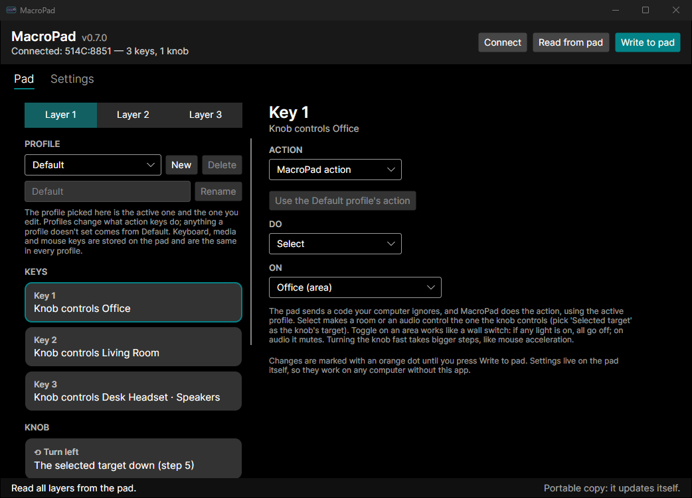
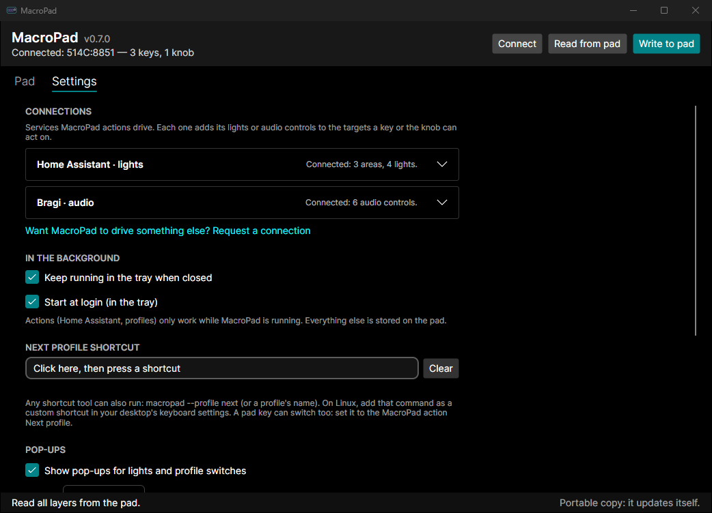
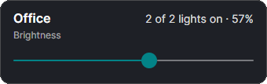

# MacroPad

A cross-platform app (Windows and Linux) for the cheap "MINI_KEYBOARD" macropads sold on AliExpress, for example the
3-key-plus-knob "Macropad Macro Programming Keyboard RGB". It replaces the vendor's Windows-only `MINI_KEYBOARD.exe`.
Built with Avalonia and .NET 10.

MacroPad does two things:

1. **Programs the pad.** Keyboard shortcuts, macros, media keys, mouse actions and the lights are written to the
   pad itself. The pad then works on any computer, without MacroPad running.
2. **Turns pad keys into actions.** A key or the knob can control your lights through Home Assistant and your audio
   through Bragi, or switch MacroPad's **profiles** (virtual layers that change what those keys do). For these,
   MacroPad runs in the tray and shows a pop-up for each change.



| Settings | Pop-up |
|---|---|
|  |  |

## Install

- **Arch / CachyOS:** `yay -S macropad-bin` (or `paru`). It installs the udev rule too, so the pad works without
  root. Updates come through pacman like any other package.
- **Windows:** download `MacroPad-win-x64.exe` from the
  [latest release](https://github.com/NickMarcha/MacroPad/releases/latest), put it in a folder of its own and run
  it. Under Settings, tick *Show MacroPad in the Start menu* to find it by search, and *Start at login* to keep it
  in the tray.
- **Other Linux:** download `MacroPad-linux-x64`, `chmod +x` it, and install the udev rule
  ([below](#linux-without-the-aur-package)). Settings → *Show MacroPad in the applications menu* adds a menu entry.

## 1. Programming the pad

The **Pad** tab reads all three of the pad's layers. Pick a key or a knob action (turn left, press, turn right),
choose what it does, and press *Write to pad*:

- a keyboard shortcut, or a macro of up to 18 steps with an optional delay between them. Record the steps by
  pressing keys, or pick keys by name (F13–F24, or keys the OS grabs);
- a media key (volume, play/pause, next track, …);
- a mouse click, wheel or move, with modifiers held.

The lights are set per layer (mode and color). Which layer the pad is on is chosen on the pad itself.

Tested with USB ID `514C:8851`. MacroPad also looks for the other IDs the vendor app supports (`1189`/`514C` with
PIDs `8830`–`8833`, `8840`, `8842`, `8850`), but those have not been tested.
[docs/protocol.md](docs/protocol.md) describes how the protocol was worked out.

## 2. MacroPad actions

Set a key or knob action to **MacroPad action** to make it drive something else:

| Action | Lights (Home Assistant) | Audio (Bragi) |
|---|---|---|
| Toggle | on/off; on an area like a wall switch: anything on turns all off | mute/unmute |
| Turn on / Turn off | on / off | unmute / mute |
| Up / Down | brightness | volume, up to 150% |
| Select | makes it the knob's *Selected target* | the same |
| Next profile / Profile | switches MacroPad's profile | |

How it works: the pad can only send key codes, so an action key is written as a consumer-control code from an
unused range (`0x0F00`–`0x0F7F`) that Windows and Linux ignore. MacroPad reads the pad's reports in the background
(without taking them from the OS, and on Wayland too) and does the action. What each code does lives in
MacroPad's settings, so actions only work while MacroPad runs: leave it in the tray, and tick *Start at login*.

**The knob.** Turns accelerate like a mouse pointer: a single click moves the set step (5/255 of full by default;
1 is the finest a light takes), and quick clicks in the same direction move up to 8 times as much. While you turn,
MacroPad keeps the level itself and sends exact values, so fast turns can't make a light jump. A typical setup:
keys 1–3 *Select* a room or a headset, the knob's press is *Toggle* and its turns *Down* and *Up*, all on
*Selected target*. The keys then choose what the knob works on.

**Pop-ups.** Each change shows the target, its level and a slider you can drag (Settings → Pop-ups: on/off, and
which of nine places on the screen).

### Profiles (virtual layers)

The pad's own layers can't be switched from the computer (the vendor app has no command for it either), so
MacroPad has profiles. A profile says what each action key does; anything a profile doesn't set comes from
**Default**, so a key set to *Next profile* in Default works in every profile. Each profile remembers its own
selected target. Keyboard, media and mouse bindings are stored on the pad and are the same in every profile.

The profile picked in the window is the active one and the one you edit. To switch otherwise:

- the tray icon's right-click menu (the active profile is ticked);
- a pad key set to *Next profile* or *Profile*;
- a keyboard shortcut: on Windows, set one under Settings → *Next profile shortcut*; anywhere, have a shortcut run
  `macropad --profile next` or `macropad --profile <name>` (on Linux, in your desktop's keyboard settings);
- the command line: a second `macropad` hands its arguments to the running one, so only one ever runs.

Per-application profiles would build on this: a rule that picks the profile for the app in front.

## Connections

Settings → **Connections** lists the services MacroPad drives. Each one, once connected, adds its lights or audio
controls to the targets an action can use.

### Home Assistant (lights)

1. In Home Assistant, open your profile → Security → *Long-lived access tokens* and create one.
2. In MacroPad, open **Home Assistant**, paste the address (a dashboard link works too) and the token, and press
   Connect. Areas that have lights, and every light, become targets.

### Bragi (audio)

[Bragi](https://github.com/NickMarcha/bragi) is a PipeWire audio mixer with a REST API (its server describes it at
`/api/v1/help`).

1. In Bragi's dashboard, open the lock button → Security → *API connections* and make a key.
2. In MacroPad, open **Bragi**, enter its address and the key, and press Connect. Every control becomes a target:
   a headset's speakers and mic, and each network peer's outgoing and incoming audio.

A control that isn't streaming says so in the pop-up instead of changing. Turning the volume doesn't unmute.

### Something else?

Use *Request a connection* under Connections, or
[open a connection request](https://github.com/NickMarcha/MacroPad/issues/new?template=connection_request.yml).
Point to the service's API and say what the pad should do with it.

Settings are in `%APPDATA%\MacroPad\settings.json` (Windows) or `~/.config/macropad/settings.json` (Linux). The
Home Assistant token and the Bragi key are encrypted for your Windows user; on Linux the file is readable only by
you.

## Updates

The app checks GitHub for a newer release when it starts (and on Settings → About → *Check for updates*). Settings
→ About and the bottom bar say how this copy is installed:

- **Portable copy** (the `.exe`, or the Linux binary in a folder you can write): *Update now* downloads the new
  release, checks its SHA-256, swaps itself and restarts.
- **Installed by pacman** (the AUR package writes `/opt/macropad/package-managed`): it only tells you a new version
  is out. Update it with `yay -Syu`.
- **Read-only folder**: it tells you a new version is out and leaves the file alone.

Local builds report version 0.0.0 and never update.

## Problems and requests

Settings → About has links that open these forms with your MacroPad version, system and pad already filled in:

- [Report a problem](https://github.com/NickMarcha/MacroPad/issues/new?template=bug_report.yml)
- [Request hardware support](https://github.com/NickMarcha/MacroPad/issues/new?template=hardware_support.yml), for
  a pad MacroPad doesn't find or doesn't program correctly
- [Request a connection](https://github.com/NickMarcha/MacroPad/issues/new?template=connection_request.yml)

For timing problems with the knob or pop-ups, start MacroPad with `MACROPAD_TRACE=1` set; it logs to
`macropad-trace.log` in your temp folder.

## Linux without the AUR package

Normal users cannot open the pad's raw HID interface until a udev rule allows it:

```sh
sudo cp packaging/linux/70-macropad.rules /etc/udev/rules.d/
sudo udevadm control --reload && sudo udevadm trigger
```

Then replug the pad. The rule tags the device `uaccess`, which gives the logged-in desktop user access on systemd
distros.

## Build and run from source

```sh
dotnet run --project src/MacroPad.App
dotnet test
dotnet publish src/MacroPad.App -c Release -r linux-x64 -o out   # or -r win-x64; one self-contained file
```

## Releasing

Push a tag: `git tag v0.8.0 && git push origin v0.8.0`. `.github/workflows/release.yml` tests, builds Windows and
Linux, publishes the GitHub release and updates the AUR package ([packaging/aur/README.md](packaging/aur/README.md)
covers the one-time AUR setup).

## Layout

- `src/MacroPad.Core`: protocol encoding (`Protocol.cs`), binding types, HID access through HidSharp
  (`MacroPadDevice.cs`), the background listener (`PadListener.cs`), actions and profiles (`PadAction.cs`),
  settings (`AppSettings.cs`), targets and the service interface (`Target.cs`), the knob's dial (`LevelDial.cs`),
  the Home Assistant client (`HomeAssistant/`), the Bragi client (`Bragi/`), key and media names, and install
  detection and self-update (`Updates/`).
- `src/MacroPad.App`: the Avalonia UI.
- `tests/MacroPad.Core.Tests`: protocol tests built from real reports the pad sent, and tests for the services,
  profiles, the dial and updates.
- `packaging/`: the Linux desktop entry, icon and udev rule, and the AUR package.
- `.github/ISSUE_TEMPLATE/`: the problem, hardware and connection forms.

## Known limitations

- The pad cannot report its current light setting, so the lights panel shows what you are about to set, not what is
  on the pad now.
- Tested on Windows. The Linux build compiles and packages but has not been run against the pad on Linux yet.
- The Windows build is not code-signed, so SmartScreen warns the first time it runs.
- Modifiers you record are always the left-hand ones.
- Keys the OS takes before the app sees them (Win, Alt+Tab, Print Screen on some desktops) need the "add a key by
  name" picker instead of recording.

## License

[PolyForm Noncommercial 1.0.0](LICENSE.md).
